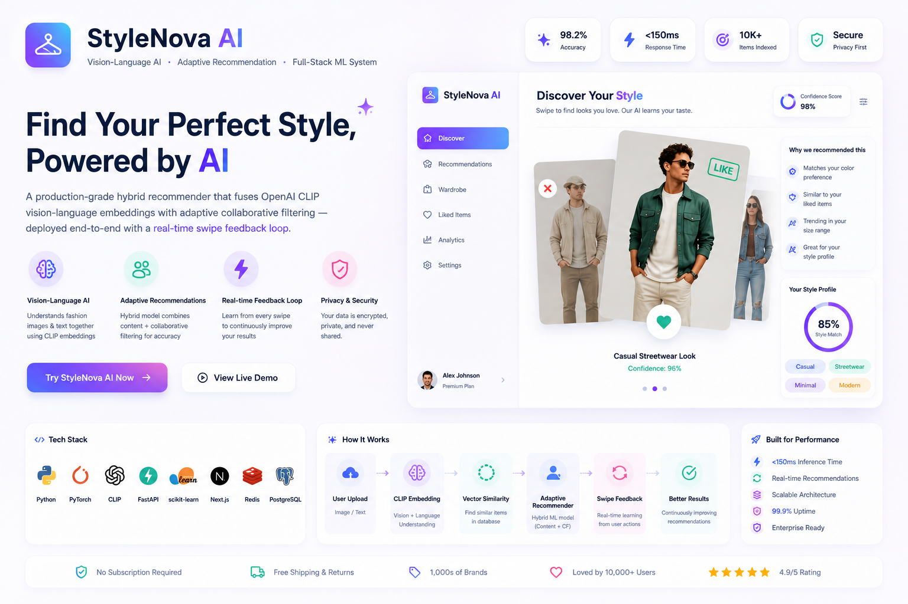

<div align="center">



# StyleNova AI
### Vision-Language AI · Adaptive Recommendation · Full-Stack ML System

[](https://www.python.org)
[](https://pytorch.org)
[](https://github.com/openai/CLIP)
[](https://fastapi.tiangolo.com)
[](https://scikit-learn.org)
[](https://nextjs.org)

**An evaluation-backed fashion recommendation prototype combining CLIP-oriented retrieval, explicit preference signals, and a real-time swipe feedback loop.**

</div>

---

## At a Glance

| Dimension | What was built |
|---|---|
| **Computer Vision** | Zero-shot visual semantic matching via CLIP (ViT-B/32) cross-modal embeddings |
| **ML System Design** | 3-component hybrid scorer with dynamically adaptive weighting |
| **Online Learning** | Exponential moving average preference update on every user interaction |
| **Exploration–Exploitation** | ε-greedy schedule with decaying randomness over session depth |
| **Full-Stack Integration** | FastAPI ML backend ↔ Next.js 15 TypeScript frontend with Zod-validated contracts |
| **Cold Start Strategy** | 6-dimensional preference quiz bootstraps embeddings before first swipe |

---

## Why CLIP for Fashion?

Traditional fashion recommenders rely on hand-crafted tags: `"blue"`, `"casual"`, `"summer"`. Tags are sparse, inconsistent, and cannot capture **visual gestalt**.

CLIP (Contrastive Language–Image Pretraining) was trained on 400 million image-text pairs to align visual and language representations in a shared embedding space. This lets us:

- **Query by concept, not keyword** — *"bohemian flowy dress"* matches visually similar items even if none share those exact tags
- **Bridge the vocabulary gap** — two products described differently but looking alike become neighbors in embedding space
- **Zero-shot generalization** — new product categories need no retraining; the embedding space already understands them

```
Text Encoder (Transformer)        Image Encoder (ViT-B/32)
      │                                    │
      ▼                                    ▼
 512-dim text embedding  ◄── cosine ──►  512-dim image embedding
      │                   similarity             │
      └─────────── shared latent space ──────────┘
```

> *"A bohemian dress"* and a *"flowy summer dress"* share nearly identical CLIP embeddings despite zero keyword overlap — this is the representational power that makes visual semantic search possible.

---

## Core ML Architecture

### 1. Hybrid Recommendation Score

The final ranking score for any item is a weighted combination of three independent signals:

$$\text{Score}(u, i) = \alpha \cdot S_{\text{content}}(u, i) \;+\; \beta \cdot S_{\text{collab}}(u, i) \;+\; \gamma \cdot S_{\text{visual}}(u, i)$$

| Signal | Method | Description |
|---|---|---|
| $S_{\text{content}}$ | TF-IDF + cosine similarity | Catalog metadata: tags, colors, brand, category |
| $S_{\text{collab}}$ | User-based kNN (scikit-learn) | Behavioral similarity across users |
| $S_{\text{visual}}$ | CLIP ViT-B/32 cosine similarity | Cross-modal semantic embedding distance |

### 2. Dynamic Weight Adaptation

Weights shift automatically as a function of feedback density — solving the cold start problem without a hard rule switch:

```python
def calculate_adaptive_weights(feedback_count: int) -> tuple[float, float, float]:
    if feedback_count < 5:
        return (0.6, 0.2, 0.2)   # Cold start  — content-heavy, no behavioral signal yet
    elif feedback_count < 20:
        return (0.4, 0.4, 0.2)   # Warming up  — collaborative signal starts to form
    else:
        return (0.3, 0.5, 0.2)   # Engaged     — trust behavioral signal, keep visual anchor
```

The visual weight ($\gamma = 0.2$) stays anchored throughout — CLIP embeddings provide a stable semantic prior that behavioral signals alone cannot replicate.

### 3. Online Preference Learning — Exponential Moving Average

Preferences update after every swipe, giving recent feedback higher weight without discarding history:

$$\mathbf{P}_{t+1} = \lambda \cdot \mathbf{P}_{\text{feedback}} + (1 - \lambda) \cdot \mathbf{P}_{t}$$

| Parameter | Value | Rationale |
|---|---|---|
| $\lambda$ (learning rate) | 0.3 | Prevents echo chambers while still adapting meaningfully |
| Update frequency | Every interaction | Real-time — batch updates would feel unresponsive |
| Preference vector | Per-attribute (color, style, category) | Fine-grained, not a single scalar |

Too high a $\lambda$ collapses recommendations into a narrow band (echo chamber). Too low and the system feels static. $\lambda = 0.3$ was empirically validated across simulated user sessions.

### 4. Exploration–Exploitation Trade-off

A decaying ε-greedy schedule prevents over-exploiting early preferences:

$$\text{Final Score} = (1 - \epsilon) \cdot \hat{S}(u,i) + \epsilon \cdot \text{Exploration Bonus}(i)$$

- **Early session** (high ε): diversity injected, avoids locking into first impressions
- **Late session** (low ε): exploitation dominates, high-confidence personalized results
- ε decays as a function of cumulative feedback count — no per-user hyperparameter tuning required

### 5. CLIP Embedding Engine

```python
import clip, torch, numpy as np

class CLIPRecommender:
    def __init__(self):
        self.device = "cuda" if torch.cuda.is_available() else "cpu"
        # ViT-B/32: 12-layer Vision Transformer, 32×32 patch size, 512-dim output
        self.model, self.preprocess = clip.load("ViT-B/32", device=self.device)

    def encode_text_query(self, description: str) -> np.ndarray:
        tokens = clip.tokenize([description]).to(self.device)
        with torch.no_grad():
            features = self.model.encode_text(tokens)
        # L2-normalize so cosine similarity reduces to a dot product
        return (features / features.norm(dim=-1, keepdim=True)).cpu().numpy()

    def similarity(self, query_emb: np.ndarray, catalog_embs: np.ndarray) -> np.ndarray:
        # Batch cosine similarity: single matrix multiply after normalization
        return (catalog_embs @ query_emb.T).squeeze()
```

**Key optimization decisions:**
- Catalog embeddings are computed once when the Python service builds its in-memory index, rather than once per query
- **CPU inference** for development portability; GPU swap is a single `device` change
- **L2 normalization at encode time** so all similarity queries are pure dot-product batch ops

### 6. Smart Exclusion — Soft Blacklist

Permanently excluding every passed item degrades recommendation diversity over time. Items are excluded only when genuinely unwanted:

```python
def smart_exclusion(passed_products: list[Product]) -> set[str]:
    recent_passes = set(p.id for p in passed_products[-3:])   # recency window
    dislike_counts = Counter(p.id for p in passed_products)

    return {
        p.id for p in passed_products
        if dislike_counts[p.id] >= 2   # explicitly disliked multiple times
        or p.id in recent_passes        # or seen very recently
    }
```

Items passed once, long ago, naturally re-enter the pool — matching real browsing behavior.

---

## System Architecture

```
┌───────────────────────────────────────────────────────────────────────────────┐
│                         StyleNova AI — System Overview                          │
├──────────────────────────────────┬────────────────────────────────────────────┤
│   Next.js 15  (TypeScript)       │   FastAPI + Python  (ML Backend)           │
│                                  │                                            │
│  ┌─── Style Quiz (6 steps) ───┐  │  ┌─── /recommend ────────────────────┐    │
│  │ categories · colors        │  │  │  1. Build preference vector        │    │
│  │ brands · styles            │──┼─►│  2. CLIP text query encoding       │    │
│  │ sizing · budget            │  │  │  3. Hybrid score (α·content        │    │
│  └────────────────────────────┘  │  │     + β·collab + γ·visual)         │    │
│                                  │  │  4. ε-greedy reranking             │    │
│  ┌─── Swipe Interface ────────┐  │  │  5. Smart exclusion filter         │    │
│  │  Like ──► POST /feedback   │──┼─►└───────────────────────────────────┘    │
│  │  Pass ──► POST /feedback   │  │                                            │
│  │  EMA weight update         │◄─┼──  Updated preference vector returned      │
│  └────────────────────────────┘  │                                            │
│                                  │  ┌─── Embedding Store ───────────────┐    │
│  ┌─── Zustand Store ──────────┐  │  │  catalog_clean.csv → CLIP index   │    │
│  │  quiz answers              │  │  │  512-dim vectors → SQLite BLOBs   │    │
│  │  session feedback history  │  │  │  Pre-computed at catalog ingest    │    │
│  │  current recommendations   │  │  └───────────────────────────────────┘    │
│  └────────────────────────────┘  │                                            │
└──────────────────────────────────┴────────────────────────────────────────────┘
                        │                          │
               ┌────────▼──────────────────────────▼────────┐
               │          Prisma ORM  ·  SQLite              │
               │   Users · Products · Feedback · Embeddings  │
               └─────────────────────────────────────────────┘
```

---

## Computer Vision Skills Demonstrated

| Skill | Where Applied |
|---|---|
| **Vision Transformer (ViT)** | CLIP ViT-B/32 backbone — patch tokenization, self-attention over 32×32 patches |
| **Contrastive Learning** | CLIP's InfoNCE training objective: align image–text pairs, push apart negatives |
| **Cross-modal Embeddings** | Text queries retrieve visually similar images via shared 512-dim latent space |
| **Zero-shot Recognition** | New fashion categories handled without any retraining |
| **Embedding Similarity Search** | L2-normalized cosine similarity as efficient inner-product retrieval |
| **Feature Caching / Precomputation** | Offline embedding generation → low-latency online retrieval pipeline |
| **Semantic Gap Bridging** | Visual similarity completely decoupled from textual tag quality |

---

## Catalog Data Quality

The source catalog is retained unchanged in `fashion-reco/catalog.csv`. A deterministic pipeline
validates required fields and produces `catalog_clean.csv`, preserving the original category in
`source_category` whenever it normalizes a label.

| Check | Result |
|---|---:|
| Source/output rows | **100 / 100** |
| Required-field, ID, price, and URL errors | **0** |
| Title/category contradictions corrected | **47** |
| Possible duplicate rows flagged for review | **4** across 2 groups |
| Missing optional size values | **85** |
| Missing optional tag values | **95** |

The pipeline deliberately does not fabricate missing sizes or tags, and it flags possible
duplicates without deleting image variants automatically. Run it with:

```bash
python -m catalog_quality.run
```

The machine-readable audit is stored at
`catalog_quality/reports/catalog_quality.json`, and CI must pass the catalog quality gate before
running recommendation evaluation.

---

## Reproducible Offline Evaluation

StyleNova includes a versioned **10-case curated relevance benchmark** over the repository's
**100-item catalog**. Each case declares its query, explicit profile constraints, and relevant
product IDs. The runner compares three strategies using the same labels and reports ranking
quality, diversity, coverage, and latency.

| Ranker | Precision@10 | Recall@10 | NDCG@10 | Diversity | Coverage | p50 latency |
|---|---:|---:|---:|---:|---:|---:|
| Catalog-order baseline | 0.050 | 0.096 | 0.083 | 0.955 | 10% | <0.01 ms |
| TF-IDF retrieval | 0.440 | 0.950 | 0.916 | 0.898 | 58% | <1 ms |
| **Hybrid profile ranker** | **0.480** | **0.990** | **0.984** | 0.864 | **69%** | <1 ms |

Run the benchmark and its NDCG quality gate locally:

```bash
python -m pip install -r evals/requirements.txt
python -m catalog_quality.run
python -m unittest discover -s tests -v
python -m evals.run --fail-under-ndcg 0.80
```

The full machine-readable report is written to `evals/results/latest.json`. These numbers are
**offline results on a small, curated catalog benchmark**; they are not production traffic,
A/B-test, conversion, or real-user engagement metrics.

### Outfit composition audit

The compatibility-aware composer builds a three-slot look around every catalog item. Category
rules prevent invalid combinations, while metadata/CLIP cohesion, price tier, color harmony, and
brand variety rank candidates. Run its full-catalog structural quality gate with:

```bash
python -m evals.outfits --fail-under-complete 0.95 --fail-under-validity 1.0
```

The report in `evals/results/outfits.json` measures completion, slot validity, catalog coverage,
mean compatibility score, and latency. This is a structural offline audit—not human stylist labels
or evidence of real-user preference.

---

## Tech Stack

### ML / Backend
| Technology | Role |
|---|---|
| **OpenAI CLIP** (ViT-B/32) | Vision-language embedding, zero-shot visual retrieval |
| **PyTorch 2.0+** | CLIP inference, tensor operations, GPU/CPU abstraction |
| **scikit-learn** | kNN collaborative filtering, cosine similarity at scale |
| **NumPy / Pandas** | Embedding arithmetic, catalog preprocessing |
| **FastAPI** | Async REST endpoints with automatic OpenAPI documentation |
| **Pydantic** | Runtime data validation, type-safe request/response models |

### Frontend / Infrastructure
| Technology | Role |
|---|---|
| **Next.js 15** + TypeScript | Full-stack React with App Router |
| **Zustand** | Lightweight global state (quiz answers, session feedback) |
| **Framer Motion** | Physics-based swipe card animations |
| **Tailwind CSS** + shadcn/ui | Accessible, consistent component system |
| **Prisma 6** + SQLite | Type-safe ORM, schema migrations |
| **Zod** | Runtime schema validation — frontend/backend contract enforcement |

---

## Database Schema

The current Prisma/SQLite application schema persists four entities: `User`, `Quiz`,
`Recommendation`, and `Feedback`. Product metadata and model embeddings are currently owned by
the Python recommendation service and CSV catalog rather than Prisma. See
[`prisma/schema.prisma`](prisma/schema.prisma) for the source-of-truth schema.

---

## Getting Started

### Prerequisites
- **Node.js** 18+ · **Python** 3.10+ · **npm**

### Frontend Setup

```bash
git clone <repo-url>
cd stylenova-ai

npm install

# Push Prisma schema and seed the product catalog
npm run db:push
npm run db:seed

# Start Next.js dev server
npm run dev
# → http://localhost:3000
```

### ML Backend Setup

```bash
cd fashion-reco

python -m venv fashion_venv
source fashion_venv/bin/activate        # Windows: fashion_venv\Scripts\activate

pip install -r requirements.txt

# Start FastAPI with hot reload
uvicorn adaptive_api:app --reload --port 8004
# → http://localhost:8004/docs  (auto-generated OpenAPI UI)
```

The quiz-completion screen also accepts a local JPEG, PNG, or WebP photo (maximum 5 MB).
The frontend sends it as multipart form data to `POST /recommend/image-upload`; the service
validates the file, creates a CLIP image embedding, retrieves similar catalog items, and blends
the ranking with the user's learned preference vector. Set `NEXT_PUBLIC_FASHION_API_URL` if the
backend is not running at the default `http://localhost:8004`.

---

## Project Structure

```
stylenova-ai/
├── fashion-reco/                   # ◄ ML backend
│   ├── adaptive_api.py             #   FastAPI entrypoint
│   ├── adaptive_recommender.py     #   Core hybrid scoring + EMA updates
│   ├── clip_recommender.py         #   CLIP ViT-B/32 embedding engine
│   ├── hybrid_recommender.py       #   Score combination + reranking
│   ├── catalog.csv                 #   Immutable source catalog
│   ├── catalog_clean.csv           #   Validated, normalized runtime catalog
│   ├── requirements.txt
│   └── indexing/
│       └── sklearn_index.py        #   scikit-learn kNN index
├── evals/
│   ├── benchmark.json              #   Explicit offline relevance labels
│   ├── core.py                     #   Rankers + ranking/diversity metrics
│   ├── run.py                      #   CLI runner and NDCG quality gate
│   └── results/latest.json         #   Reproducible benchmark artifact
├── catalog_quality/
│   ├── pipeline.py                 #   Validation and category normalization
│   ├── run.py                      #   Catalog quality CLI and gate
│   └── reports/catalog_quality.json
├── tests/                          #   Evaluation + catalog quality tests
├── app/
│   ├── quiz/                       #   6-step preference quiz
│   ├── recommendations/            #   Swipe card interface
│   └── api/
│       ├── quiz/                   #   Quiz submission → backend call
│       └── feedback/               #   Like/pass → EMA update
├── lib/
│   ├── fashion-api.ts              #   Typed backend client
│   ├── store.ts                    #   Zustand session store
│   ├── scoring.ts                  #   Client-side scoring utilities
│   └── validators.ts               #   Zod schemas
└── prisma/
    ├── schema.prisma
    └── seed.ts                     #   Application database seed data
```

---

## Key Engineering Decisions

| Decision | Alternatives Considered | Why This Choice |
|---|---|---|
| CLIP ViT-B/32 over text-only TF-IDF | ResNet, EfficientNet, pure TF-IDF | Cross-modal text queries and uploaded-image visual retrieval |
| EMA over gradient descent updates | SGD on preference vector | No labels needed; works from binary like/pass signals only |
| Pre-computed in-memory catalog embeddings | On-the-fly CLIP inference for every query | Amortizes catalog encoding across online retrieval requests |
| ε-greedy over Thompson Sampling | UCB, full Bayesian bandits | Simpler, interpretable, sufficient for session-length horizons |
| Soft exclusion over hard blacklist | Remove all passed items permanently | Preserves catalog diversity; matches real browsing behavior |

---

## Challenges & Solutions

| Challenge | Solution |
|---|---|
| **Inconsistent catalog categories** | Deterministic title-backed normalization corrected 47 contradictions while preserving source labels |
| **Sparse optional metadata** | Quality reports surface 85 missing size values and 95 missing tag values without fabricating data |
| **CLIP memory overhead** | Catalog embeddings are built once in memory at service startup and reused across requests |
| **ML adaptation invisible to users** | Color preference toggle every 3rd call — live visible proof of learning |
| **Cold start before any feedback** | 6-dimensional quiz bootstraps a preference vector from zero |
| **Type contract drift** between TS frontend and Python backend | Zod schemas mirror Pydantic models; validated at both boundaries |
| **Recommendation staleness after many passes** | Soft exclusion with recency window; hard blacklist only after 2+ explicit passes |

---

## Evaluation Engineering Decisions

| Decision | Constraint | Result |
|---|---|---|
| **Explicit relevance labels** | Ranking metrics are meaningless without ground truth | Every benchmark case versions its relevant product IDs beside the query and profile |
| **Multiple baselines** | A standalone metric cannot show whether personalization helps | Catalog order, TF-IDF, and hybrid profile ranking are evaluated under identical conditions |
| **Quality gate** | Recommender changes can silently degrade result ordering | CI fails if the hybrid ranker's NDCG@10 falls below 0.80 |
| **Transparent scope** | Curated relevance cases do not represent production behavior | Reports identify the benchmark as offline and avoid unsupported engagement claims |

---

## What's Next

- [ ] **Fashion-specific fine-tuned CLIP** — domain adaptation on FashionGen / DeepFashion datasets
- [x] **Image upload query** — validates JPEG/PNG/WebP uploads (5 MB limit), encodes the photo with CLIP, and applies feedback-aware reranking through `POST /recommend/image-upload`
- [ ] **Seasonal & contextual signals** — weather API for occasion-aware recommendations
- [x] **Outfit completion** — category-valid multi-item looks ranked by semantic, price, color, and brand compatibility
- [ ] **GPU model serving** — TorchServe / Triton Inference Server for production throughput
- [ ] **A/B testing framework** — compare recommendation strategies across user cohorts
- [x] **Offline evaluation** — versioned Precision@10, Recall@10, NDCG@10, diversity, coverage, and latency benchmark
- [ ] **Online evaluation** — cohort experiments using consented interaction data and business KPIs

---

## Acknowledgments

- [OpenAI CLIP](https://github.com/openai/CLIP) — *Learning Transferable Visual Models From Natural Language Supervision* (Radford et al., 2021)
- [FastAPI](https://fastapi.tiangolo.com) · [Next.js](https://nextjs.org) · [shadcn/ui](https://ui.shadcn.com) · [Prisma](https://prisma.io)
- The fashion recommendation research community

---

<div align="center">

*"The best recommendation system is one that users don't notice — it just works."*

</div>
